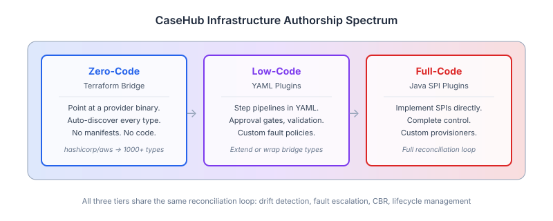
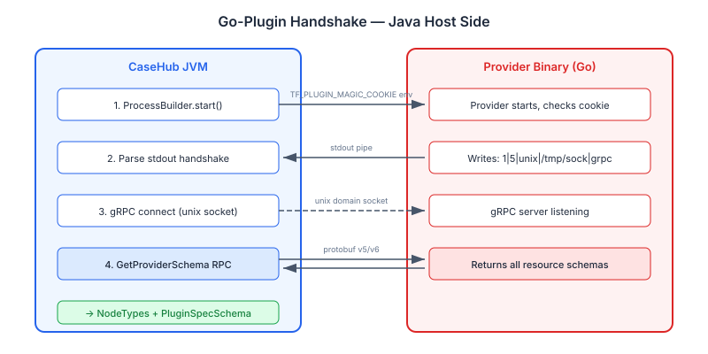
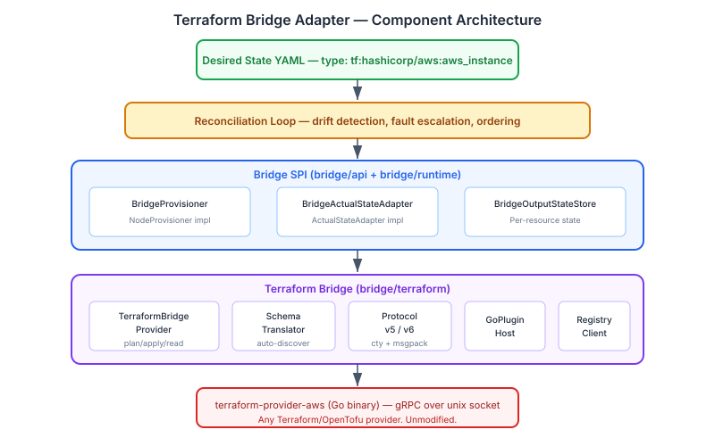

# Bringing Terraform Providers into CaseHub — Zero-Config, Full Reconciliation

Terraform providers already know how to provision infrastructure. Thousands of them exist,
covering every cloud service, SaaS product, and internal tool you can name. The provisioning
knowledge is right there — encoded in Go binaries that speak a well-defined gRPC protocol.

The question I've been thinking about: what if CaseHub could use that knowledge directly?
Not by wrapping Terraform CLI. Not by reimplementing what providers already do. By speaking
the same protocol they speak — the go-plugin gRPC interface — and letting them do what
they're good at, while CaseHub does what *it's* good at: continuous reconciliation, drift
detection, fault escalation, dependency-aware ordering, and lifecycle management.

That's what the Terraform bridge adapter does. Point it at a provider binary — or just
declare `hashicorp/aws` — and every resource type that provider supports is immediately
available in your desired-state graph. No manifests. No type declarations. No code.

## The Spectrum That Makes This Interesting

CaseHub now has three ways to define infrastructure resources, and no other platform
offers this combination:

**Zero-code** is the bridge. Auto-discover types from a Terraform provider. Write a YAML
graph referencing `tf:hashicorp/aws:aws_instance` and CaseHub validates the spec, plans
the change, provisions the resource, and reconciles it — all without anyone writing a
manifest or a line of Java.

**Low-code** is the YAML plugin layer. Want to add an approval gate before provisioning
a database? A pre-provision validation step? A custom fault policy that escalates to a
human after three failures? Write a YAML plugin that wraps the bridge type. Step pipelines
compose on top of the bridge underneath.

**Full-code** is the Java SPI. When you need complete control — a provisioner that talks
to an internal API with custom retry logic and circuit breaking — implement `NodeProvisioner`
directly.

The point isn't that one is better than the others. The point is that all three land in
the same reconciliation loop. A Terraform-bridged `aws_rds_instance` sitting next to a
YAML-plugin `monitoring_endpoint` sitting next to a Java-plugin `casehub_agent` — they all
get the same drift detection, the same fault escalation (auto-fix, AI, human), the same
CBR-based recovery, the same pending approval gates, the same lifecycle management. Terraform
alone gives you plan/apply. CaseHub gives you continuous reconciliation with everything
that entails.

## Speaking the Protocol

Terraform providers are Go binaries that implement HashiCorp's go-plugin framework. The
host-side protocol is straightforward: start the binary, set a magic cookie environment
variable, read a handshake line from stdout, and connect via gRPC.

The handshake line is pipe-separated: `1|5|unix|/tmp/plugin4115822609|grpc`. Core protocol
version, app protocol version (5 or 6 — we support both), network type, address, and
transport. On macOS and Linux the default transport is unix domain sockets, which required
native Netty KQueue/Epoll support in the gRPC channel — a detail that took some debugging
to get right. The provider won't start without the correct magic cookie
(`TF_PLUGIN_MAGIC_COOKIE` with a specific SHA-256 hash), a guard that prevents accidental
direct execution.

Once connected, the protocol is standard gRPC with protobuf messages. The two protocol
versions — v5 and v6 — differ mainly in how state values are encoded. V5 uses JSON for
its `DynamicValue` fields. V6 uses msgpack. Both use Terraform's `cty` type system
underneath (string, number, bool, list, set, map, object, tuple). We abstract this behind
a `TerraformProtocol` interface with `ProtocolV5Adapter` and `ProtocolV6Adapter`
implementations, and a `CtyDecoder` that handles the type-system translation in both
directions.

## Zero-Config Schema Discovery

This is the part I find genuinely exciting.

Every Terraform provider implements a `GetProviderSchema` RPC. Call it, and the provider
returns the complete schema of every resource type it supports — every attribute, its type,
whether it's required or optional or computed, its description, whether it's sensitive.
The AWS provider returns over a thousand resource types this way. It's a programmatic schema
introspection API.

`SchemaTranslator` takes that response and produces CaseHub types automatically:

| Terraform | CaseHub |
|-----------|---------|
| Resource type `aws_instance` | `NodeType.of("tf:hashicorp/aws:aws_instance")` |
| Attribute `ami` (string, required) | `PluginFieldDef("STRING", required=true)` |
| Attribute `instance_type` (string, optional) | `PluginFieldDef("STRING", required=false)` |
| Attribute `id` (string, computed-only) | *Excluded from spec schema — output attribute* |

The NodeType namespace (`tf:{namespace}/{type}:{resource}`) prevents collisions with native
CaseHub types or other bridges. The `PluginSpecSchema` generated from the provider's schema
means CaseHub validates user-submitted specs at the YAML surface — before anything reaches
the provider. Submit an invalid `ami` format and the validation catches it without making
a gRPC call.

Schemas are cached to disk on first discovery and reloaded on subsequent startups.
First-time startup calls `GetProviderSchema`; every startup after that reads from the cache
unless the provider version changes.

The result: adopting a new Terraform provider is zero-config. Declare the provider, and its
resource types appear in CaseHub's type system with full spec validation. Compare that to
Crossplane, which requires a hand-written CRD per resource type, or Pulumi, which requires
SDK code generation per provider version. The knowledge already exists in the provider binary.
We just read it.

## The Architecture

The bridge module sits between CaseHub's reconciliation loop and the Terraform provider binary.
The bridge SPI from issue #183 provides the stable abstraction — `BridgeProvider`,
`BridgeProvisioner`, `BridgeActualStateAdapter` — and the Terraform module implements it.

`TerraformBridgeProvider` implements both `BridgeProvider` and `PlanCapable`. Provisioning
follows Terraform's plan-then-apply model: call `PlanResourceChange` to compute the diff,
then `ApplyResourceChange` to execute it. Deprovisioning calls plan with a null proposed
state (the Terraform convention for destroy), then applies the destroy plan. State reads
call `ReadResource` followed by `PlanResourceChange` to detect attribute-level drift — if
the plan shows changes, the resource is `DRIFTED`; if not, it's `PRESENT`.

Terraform providers are stateless. They expect the caller to track resource state between
operations — that's the `.tfstate` file in CLI Terraform. We introduced `BridgeOutputStateStore`
as a new SPI for per-resource output state persistence. On provision success, the output
state (resource IDs, ARNs, computed attributes) is stored. On subsequent operations, the
prior state is loaded and passed to the provider. On deprovision success, the state is
removed. This is distinct from `ReconciliationStateStore` (which stores desired-state graphs)
— the bridge state store holds Terraform-specific output that the provider needs to function.

Error classification maps Terraform diagnostics to `BridgeErrorCategory` — authentication
failures, validation errors, and unrecognised errors. The default is `TRANSIENT` rather
than `PERMANENT`. For infrastructure operations, most unrecognised errors are retriable
(network timeouts, cloud API outages, eventual consistency delays). The `FaultPolicyEngine`
handles escalation when retries exhaust the budget.

## Provider Registry Integration

The `ProviderRegistryClient` downloads provider binaries from `registry.terraform.io`
automatically. Declare `hashicorp/aws` at version `5.60.0` (or `latest`), and CaseHub
resolves the version, downloads the platform-appropriate binary (detecting OS and architecture
at runtime), verifies the SHA-256 checksum, extracts it, and caches it locally. Subsequent
runs use the cached binary.

For air-gapped or enterprise environments, a `binaryPath` override skips the registry
entirely — point directly at a local provider binary.

## What Comes Next

Phase 1 delivers the core: protocol, schema discovery, plan/apply, state read, registry
client. Phase 2 adds the pieces needed for production use with real cloud providers:

- **Credential resolution** via CaseHub's `CredentialResolver` — mapping tenant credentials
  to provider configuration
- **Import support** — adopting existing cloud resources into CaseHub management without
  reprovisioning them
- **Auto-mTLS** — the go-plugin framework's certificate exchange for encrypted provider
  communication
- **Cloud provider integration tests** — real AWS or GCP resources, proving the full
  lifecycle against actual infrastructure

The foundation is solid. Seventy-three unit tests cover the protocol layer, schema translation,
error classification, state persistence, registry client, and bridge provider. A standalone
integration test proves the unix socket gRPC connection works with a real `hashicorp/null`
provider, end to end — handshake, schema discovery, and all.

The broader vision is that CaseHub becomes the orchestration layer that sits above
infrastructure tooling rather than competing with it. Terraform providers represent an
enormous body of provisioning knowledge. The bridge lets CaseHub use that knowledge while
adding what Terraform doesn't have: continuous reconciliation, dependency-aware ordering
across heterogeneous resources, fault escalation with AI and human gates, and a unified
graph model that spans cloud infrastructure, application services, and business processes.

Keep your existing providers. CaseHub adds the orchestration.
