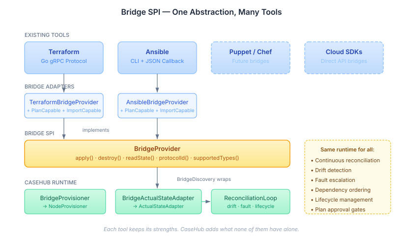
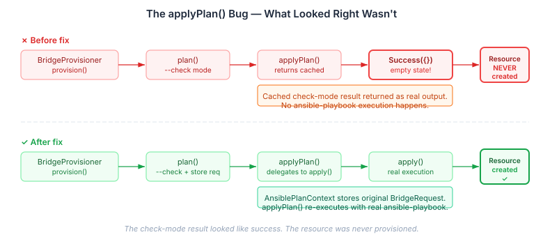

# Ansible, the Bridge SPI, and the Bug That Looked Right

A few days ago we shipped the Terraform bridge — CaseHub speaking the go-plugin gRPC protocol
directly to Terraform providers, getting zero-config schema discovery and the full reconciliation
loop for free. That entry covered the protocol details. This one is about the next adapter in
the series, and about something more interesting that fell out of it: a correctness bug that
passed every test and looked completely fine until we traced the integration path end to end.

## Why Ansible

Terraform providers speak gRPC. Ansible modules speak CLI. These are different protocols, different
execution models, different ecosystems — but they do the same thing. They provision resources.
They check state. They tear things down. The interface contract is the same; only the wire format
differs.

That's what the bridge SPI is for. `BridgeProvider` defines five methods — `apply`, `destroy`,
`readState`, `protocolId`, `supportedTypes` — plus optional mixins for plan-capable and import-capable
providers. Each bridge adapter translates one tool's protocol into these five methods. The runtime
doesn't know or care whether the resource was provisioned by a Go binary speaking protobuf over a
unix socket, or by a Python playbook writing JSON to stdout.



The Ansible adapter implements all five methods plus both mixins. Where Terraform needs gRPC channels,
mTLS handshakes, and msgpack decoding, Ansible needs `ProcessBuilder`, a temp directory, and a JSON
parser. The entire adapter is eight classes. The heaviest dependency is `jackson-dataformat-yaml`.

This isn't a complaint about Terraform's complexity — gRPC is the right choice for a Go plugin
framework, and the schema discovery it enables is remarkable. The point is that the bridge SPI
absorbs the protocol differences. The reconciliation loop sees `NodeProvisioner` and
`ActualStateAdapter` regardless of what's underneath.

## What Makes a Bridge Adapter

An Ansible module doesn't have a "read state" operation. It doesn't have a "plan" operation in the
way Terraform does. So the adapter has to *map* Ansible's capabilities onto the bridge contract.

**Provisioning** is straightforward: generate a YAML playbook with the module and parameters,
invoke `ansible-playbook` with the JSON callback plugin for structured output, parse the result.
`PlaybookGenerator` builds minimal playbooks — a single play, a single task, `gather_facts: false`.
Nothing more than what's needed.

**Deprovisioning** follows the Ansible convention: most modules accept `state: absent` to reverse
what they created. The manifest declares which strategy each type uses — `state_absent` for the
common case, `deprovision_module` for the rare exception.

**Actual state** is where it gets interesting. Ansible collections follow a convention where
resource modules have companion info modules: `ec2_instance` has `ec2_instance_info`,
`s3_bucket` has `s3_bucket_info`. The manifest declares the mapping — which info module to call,
which filter key to use, which key in the return value holds the state. The adapter extracts the
resource identifier from `previousState` (stored by the runtime after provisioning) and passes
it as a filter parameter to the info module.

**Drift detection** compares actual attributes against desired spec on configurable keys. The manifest
declares which keys matter for drift — `instance_type` and `security_groups` for an EC2 instance,
`versioning` for an S3 bucket. If any drift key differs, `readState` returns `status: "drifted"`.
The reconciliation loop picks this up and replans. Without this, Ansible-managed resources would
always report `PRESENT` regardless of configuration changes — something the design review flagged
before a line of code was written.

**Check mode** maps to `PlanCapable`. Ansible's `--check` flag runs the module in dry-run mode,
reporting what would change without changing anything. Not all modules support it — some just skip
the task — but when it works, it gives operators visibility into what will happen before execution.

## The Bug That Passed Every Test

Here's the interesting part. The initial implementation looked correct. Tests were green — fifty
of them, including the bridge TCK contract tests for `BridgeProvider`, `ImportCapable`, and
`PlanCapable`. The code compiled. The project built. Everything worked.

Except it didn't.

`BridgeProvisioner.provision()` does this when the provider implements `PlanCapable`:

```java
if (provider instanceof PlanCapable planCapable && context.approval() == null) {
    var plan = planCapable.plan(request);
    result = planCapable.applyPlan(plan);
}
```

The `plan()` call ran check mode. Good. But `applyPlan()` returned the cached check-mode result
with an empty output state — `BridgeResult.Success(Map.of())`. The resource was never actually
provisioned. Every provision through the standard `BridgeProvisioner` path silently did nothing.



The tests didn't catch it because the mock `ProcessExecutor` returned success for every invocation.
The contract tests validated that `applyPlan()` returned a non-null result — which it did. They
didn't validate that a real execution happened, because contract tests verify the protocol shape,
not the semantic correctness of a specific implementation.

The bug only surfaced when we traced the integration path manually: `BridgeProvisioner` → `plan()`
→ `applyPlan()` → where does the real `ansible-playbook` run? Nowhere. The check-mode result
was being returned as the real result.

The fix stores the original `BridgeRequest` alongside the check-mode output in an
`AnsiblePlanContext` record, and `applyPlan()` delegates to `apply()` with the stored request.
Two new tests verify this: one confirms that `applyPlan()` invokes the process executor twice
(once for check, once for real), and another confirms that the output state contains real resource
attributes, not an empty map.

## What the Audit Caught Beyond That

The `applyPlan` bug was the headline, but the full audit turned up four more issues:

**Stderr in stdout** — merging stderr into stdout with `redirectErrorStream(true)` meant that
Ansible warning messages and Python deprecation notices were prepended to the JSON output,
crashing the parser. The operation succeeded, but the adapter reported failure. The fix drains
stderr in a virtual thread to prevent pipe buffer deadlock while keeping stdout clean for
JSON parsing.

**Null resultKey NPE** — when a manifest type omits `result_key`, `Map.of().get(null)` throws
`NullPointerException` in Java 21. Unmodifiable maps don't allow null keys in `get()`. A null
guard fixed it.

**ClassCastException on malformed specs** — the spec parser cast `_extra_vars` and `_timeout` values
without type checks. If a consumer passed `_timeout: "300"` (string instead of number), it would
throw. `instanceof` guards replaced the unchecked casts.

None of these showed up in unit tests. They're integration-boundary bugs — the kind that appear
when real data flows through the system with slightly unexpected shapes or when two subsystems
interact in a way that neither one's test suite exercises.

## The Convergence Argument

There are now two bridge adapters: Terraform (gRPC, schema discovery, stateless providers) and
Ansible (CLI, manifest-declared types, info-module state reading). They share nothing except the
`BridgeProvider` interface — no common base class, no shared utilities, no framework inheritance.
Five methods and two optional mixins is the entire contract.

That's the right level of abstraction for tool convergence. Terraform's strengths are schema
introspection and provider isolation. Ansible's strengths are breadth of collection coverage and
simplicity of module authoring. CaseHub doesn't need to choose. Both land in the same
reconciliation loop with the same drift detection, fault escalation, dependency ordering, lifecycle
management, and approval gates.

The practical implication: a desired-state graph can mix Terraform-bridged cloud resources,
Ansible-bridged on-premise servers, YAML-plugin monitoring endpoints, and Java-SPI custom
provisioners. They all get the same continuous reconciliation. The runtime doesn't care how
they provision — only that they implement five methods and report status honestly.

Future bridges — Puppet, Chef, direct cloud SDK bindings — would follow the same pattern. Each
one adds coverage without changing the runtime. The SPI is the stable layer; the adapters
are the evolutionary ones.
